# 🔬 ملخص المحاضرة الثانية: علم الخلية (Cytology-II)
**المادة:** علم الأنسجة (Histology - هيستولوجي)  
**الكلية:** كلية الطب - جامعة الملك سلمان الدولية (King Salman International University)  
**المحاضر:** د. ثروت عبد اللطيف (Dr. Sarwat L.A. Abdel-Latif)  

---

## 📌 الفهرس العام للمحاضرة
1. **مقدمة وتنظيم الخلية (The Cell Organization)**
2. **اللايسوسومات (Lysosomes)**: التكوين، التركيب، الأنواع والوظائف.
3. **المشتملات الخلوية (Cell Inclusions)**:
   - الغذاء المخزن (Stored Food): الجليكوجين (Glycogen) والدهون (Lipids).
   - الصبغات الخلوية (Pigments): داخلية وخارجية المنشأ.
4. **النواة (The Nucleus)**: الغلاف النووي، السائل النووي، الكروماتين، النوية، ووظائف النواة.
5. **دليل شرائح العملي (Practical Slides Guide)** للتعرف السريع في الامتحانات.

---

## 1️⃣ مقدمة الخلية وعضيات السيتوبلازم (Cell & Organelles)

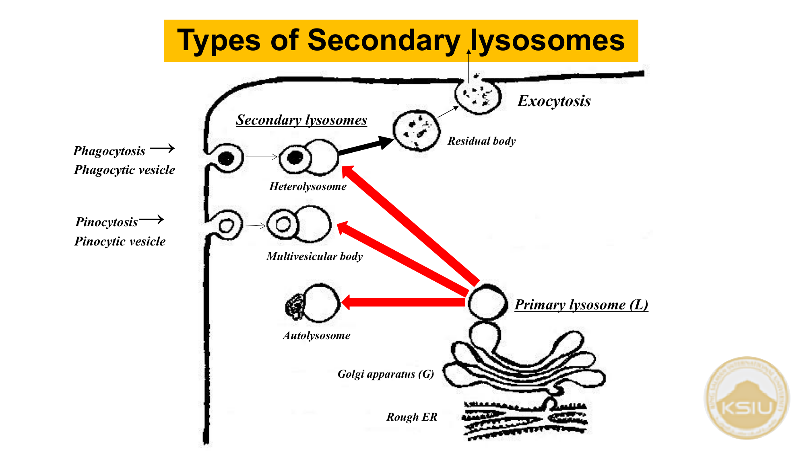

تتكون الخلية **The Cell** (ذا سيل) من جزأين رئيسيين:
1. **Cytoplasm** (سيتوبلازم): المادة الحية المحيطة بالنواة.
2. **Nucleus** (نيوكليَس): النواة ومركز التحكم.

### مكونات السيتوبلازم:
* **Cytoplasmic Matrix** (سيتوبلازميك ماتركس): السائل الأساسي الخلالي.
* **Cytoplasmic Organelles** (سيتوبلازميك أورجانيلز): العضيات الخلوية الحية ذات الوظائف المتخصصة.
* **Cytoplasmic Inclusions** (سيتوبلازميك إنكلوجنز): مشتملات غير حية ومؤقتة.

### تصنيف العضيات السيتوبلازمية (Types of Organelles):
| النوع | العضيات المشمولة | النطق الصوتي |
| :--- | :--- | :--- |
| **Membranous Organelles** (عضيات غشائية - محاطة بغشاء) | • **Cell Membrane** • **Mitochondria** • **Endoplasmic Reticulum (rER & sER)** • **Golgi Apparatus** • **Lysosomes** | (سيل ميمبرين) (مايتوكوندريا) (إندوبلازميك ريتيكيولم) (جولجي أباراتَس) (لايسوسومز) |
| **Non-membranous Organelles** (عضيات غير غشائية) | • **Ribosomes** • **Cytoskeleton**: &nbsp;&nbsp;- Microtubules (Centrioles & Cilia) &nbsp;&nbsp;- Filaments (Thin, Intermediate, Thick) | (رايبوسومز) (سايتوسكيليتون) (مايكروتيوبيولز: سينتريولز & سيليا) (فيلامنتس: ثِن، إنترميديت، ثِك) |

---

## 2️⃣ اللايسوسومات (Lysosomes - لايسوسومز)

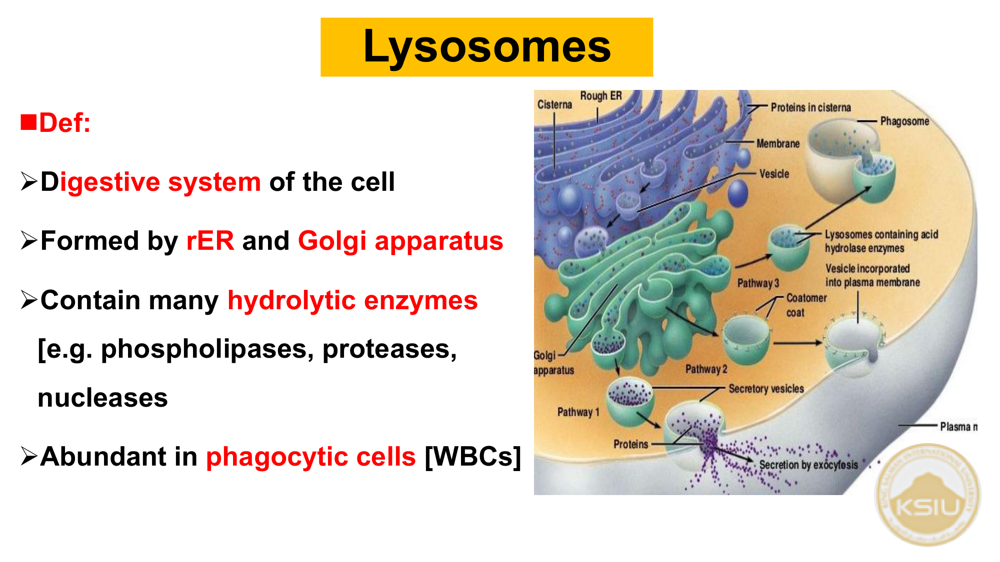

### أ) التعريف والمنشأ:
* **التعريف:** تمثل الجهاز الهضمي للخلية **Digestive system of the cell** (دايجستيف سيستم أوف ذا سيل).
* **التكوين:** تتكون بتعاون بين:
  1. الشبكة الإندوبلازمية الخشنة **Rough ER / rER** (راف إندوبلازميك ريتيكيولم): تصنع الإنزيمات الهاضمة (بروتينات).
  2. جهاز جولجي **Golgi apparatus** (جولجي أباراتَس): يقوم بتعديل وتعبئة هذه الإنزيمات وتبرعمها في حويصلات غشائية مغلقة.
* **المحتوى:** أكياس غشائية تحتوي على إنزيمات هاضمة حمضية **Hydrolytic enzymes** (هايدروليتيك إنزايمز)، مثل:
  - **Phospholipases** (فوسفو لايبيزيز): لهضم الدهون المفسفرة.
  - **Proteases** (بروتييزيز): لهضم البروتينات.
  - **Nucleases** (نيوكلييزيز): لهضم الأحماض النووية.
* **أماكن التواجد بكثرة:** وفيرة جداً في الخلايا البلعمية **Phagocytic cells** (فاجوسايتيك سيلز)، وخاصة خلايا الدم البيضاء **WBCs - White Blood Cells** (وايت بلاد سيلز).

---

### ب) فحص المجهر الإلكتروني (E.M) وأنواع اللايسوسومات:
تظهر تحت المجهر الإلكتروني بمظهر كثيف للإلكترونات **Electron-dense** (إلكترون دينس) أي معتمة/داكنة.

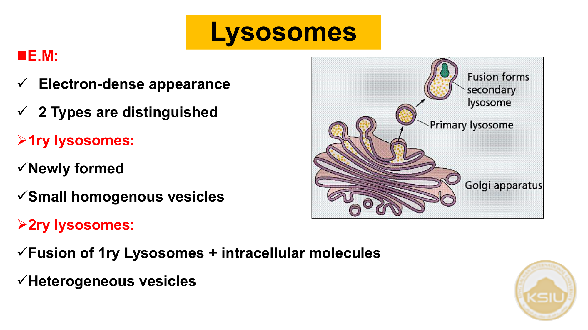

تنقسم إلى مرحلتين أساسيتين:
1. **Primary Lysosomes [1ry]** (برايمري لايسوسومز - الأولية):
   - حويصلات حديثة التكوين **Newly formed** من جهاز جولجي.
   - حويصلات صغيرة ومتجانسة المحتوى **Small homogenous vesicles** (سمول هوموجينيَس فيسيكلز).
2. **Secondary Lysosomes [2ry]** (سكندري لايسوسومز - الثانوية):
   - تتكون نتيجة اندماج اللايسوسوم الأولي مع جزيئات أو فجوات خلوية **Fusion of 1ry lysosomes + intracellular molecules**.
   - حويصلات غير متجانسة المظهر **Heterogeneous vesicles** (هيتيروجينيَس فيسيكلز) لاحتوائها على مواد في مراحل هضم مختلفة.

---

### ج) أنواع اللايسوسومات الثانوية (Types of Secondary Lysosomes):

1. **Heterolysosomes** (هيتيرو لايسوسومز):
   - **المنشأ:** اندماج لايسوسوم أولي مع فجوة بلعمية تحتوي على طعام صلب أو بكتيريا التهمتها الخلية من الخارج (**Phagocytosis** - فاجوسايتوسيز).
   - *(انظر شريحة المجهر الإلكتروني أدناه)*.
2. **Multivesicular bodies** (ملتي فيسيكيولار بوديز - الأجسام متعددة الحويصلات):
   - **المنشأ:** اندماج لايسوسوم أولي مع فجوة شرب خلوي تحتوي على قطيرات سوائل ومغذيات (**Pinocytosis** - بينوسايتوسيز).
   - *(انظر شريحة المجهر الإلكتروني أدناه)*.
3. **Autolysosomes** (أوتو لايسوسومز):
   - **المنشأ:** اندماج لايسوسوم أولي مع عضيات خلوية قديمة أو تالفة بالخلية مثل ميتوكوندريا ميتة أو قطع من الشبكة الإندوبلازمية (**Destroyed old organelles**).
   - تُعرف هذه العملية بـ **Autophagy** (أوتوفاجي - الالتهام الذاتي).
4. **Residual bodies** (ريزيدوال بوديز - الأجسام المتبقية):
   - لايسوسومات ثانوية تحتوي على بقايا غير قابلة للهضم **Indigestible remnants**.
   - قد تطردها الخلية بعملية الإخراج الخلوي **Exocytosis** (إكسوسايتوسيز) أو تترسب بالخلية مدى الحياة (مثل صبغة الليبوفيوسين).

#### 📸 صور المجهر الإلكتروني لأنواع اللايسوسومات:
| Heterolysosome | Multivesicular Body | Autolysosome |
| :---: | :---: | :---: |
| 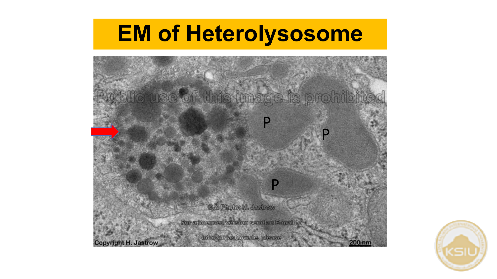 | 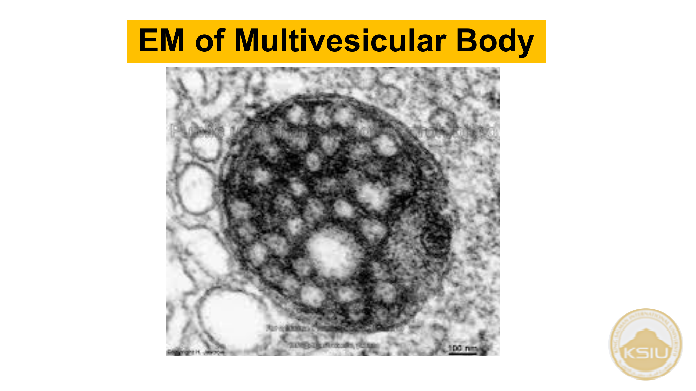 | 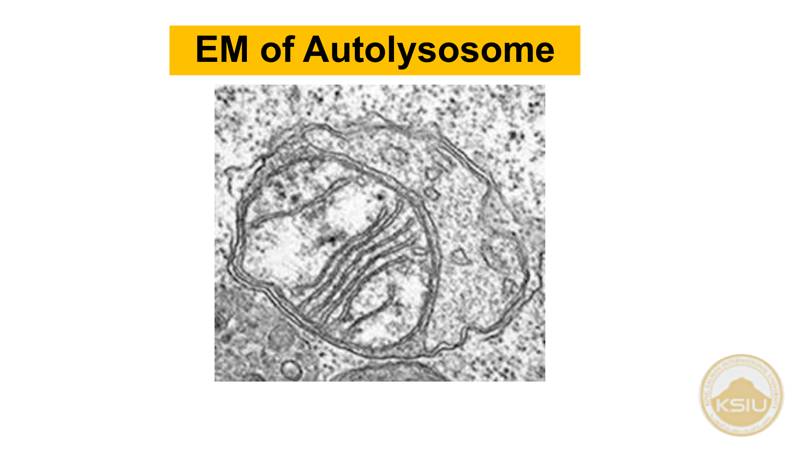 |
| **هيتيرو لايسوسوم** (يحتوي مواد وبكتيريا مبتلعة) | **ملتي فيسيكيولار بودي** (حويصلات سائلة متعددة) | **أوتو لايسوسوم** (يحتوي بقايا ميتوكوندريا وعضيات) |

---

### د) وظائف اللايسوسومات (Functions of Lysosomes):
1. هضم المغذيات داخل السيتوبلازم (**Digestion of nutrients in cytoplasm**).
2. هضم الأجسام الغريبة كالبكتيريا والفيروسات، مما يمنح الخلية وظيفة مناعية (**Immune function**).
3. هضم قطرات السوائل الممتصة (**Digestion of fluid droplets**).
4. هضم وإعادة تدوير العضيات المسنة (**Autophagy**).
5. هضم الخلية بأكملها بعد الموت المبرمج للخلية (**Autolysis after programmed cell-death** - أوتولايسيز).

---

## 3️⃣ المشتملات الخلوية (Cell Inclusions - سيل إنكلوجنز)

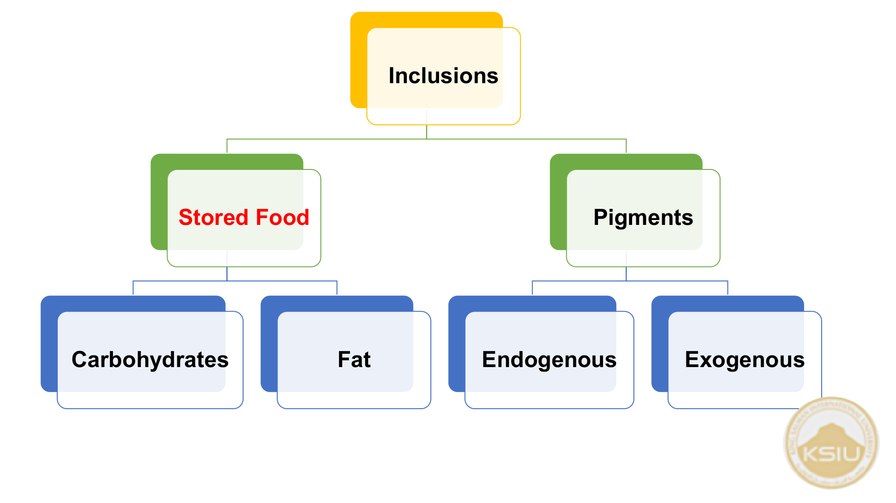

مواد كيميائية غير حية وغير دائمة تخزن في السيتوبلازم، وتنقسم إلى:
1. **Stored Food** (ستورد فود): غذاء مخزن (كربوهيدرات ودهون).
2. **Pigments** (بيجمنتس): صبغات (داخلية وخارجية المنشأ).

---

### أ) الكربوهيدرات: الجليكوجين (Carbohydrates [Glycogen] - جلايكوجين):
* **أماكن التواجد الرئيسية:** الكبد **Liver** والعضلات **Muscles**.
* **تحت المجهر الضوئي (L.M):**
  - **غير مرئي بصبغة H&E** المعتادة؛ لأنه يذوب في الماء أثناء تجهيز العينة (**Water soluble**).
  - يُصبغ بصبغات خاصة:
    1. **Best's Carmine** (بيستس كارمين): تظهره كحبيبات حمراء **Red granules**.
    2. **PAS - Periodic Acid-Schiff** (بي إيه إس): تظهره بلون بنفسجي **Purple**.

| المجهر الضوئي (Best's Carmine) | المجهر الإلكتروني (α & β Granules) |
| :---: | :---: |
| 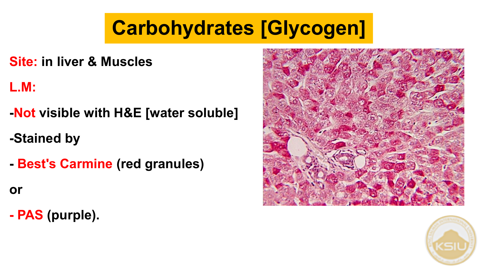 | 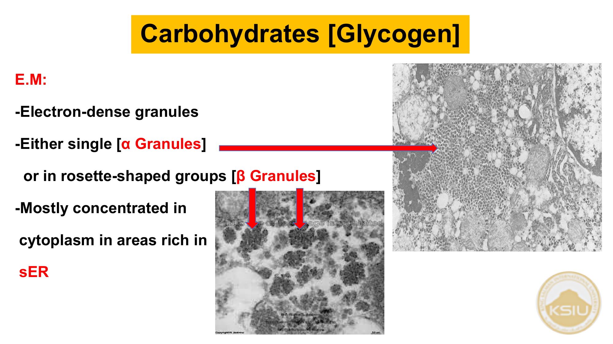 |

* **تحت المجهر الإلكتروني (E.M):**
  - يظهر كحبيبات كثيفة إلكترونياً **Electron-dense granules**.
  - يوجد في شكلين:
    1. **α Granules** (ألفا جرانيولز): حبيبات مفردة Single.
    2. **β Granules** (بيتا جرانيولز): تجمعات على هيئة ورود Rosette-shaped groups.
  - يتركز الجليكوجين في مناطق السيتوبلازم الغنية بالشبكة الإندوبلازمية الملساء **sER**.

---

### ب) الدهون (Fats [Lipids] - ليبيدز):
* **أماكن التواجد:** الخلايا الدهنية **Fat cells / Adipocytes** وخلايا الكبد **Liver**.
* **تحت المجهر الضوئي (L.M):**
  - في صبغة **H&E**: تظهر كفجوات بيضاء فارغة **Empty vacuoles**؛ لأن الدهون تذوب بفعل المذيبات العضوية أثناء تحضير الشريحة (**Dissolve during preparation**).
  - تُصبغ بصبغات دهنية خاصة (**Special stains**):
    1. **Sudan III** (سودان ثري): يعطي فجوات برتقالية **Orange vacuoles**.
    2. **Sudan Black** (سودان بلاك): يعطي فجوات سوداء **Black vacuoles**.

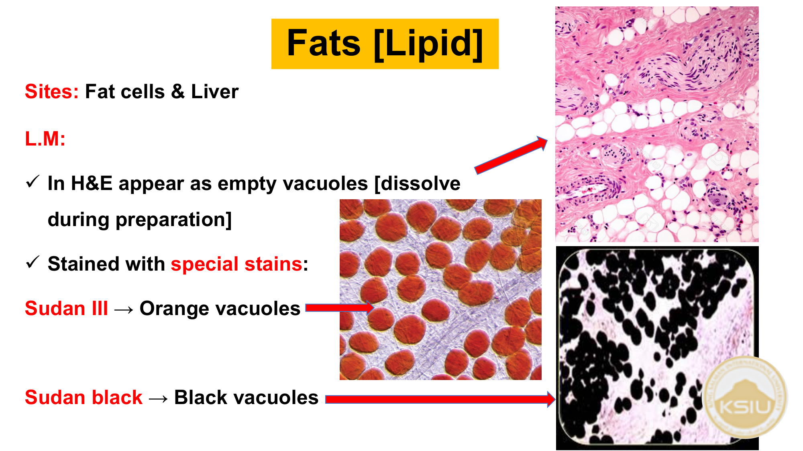

---

### ج) الصبغات الخلوية (Pigments - بيجمنتس):

#### 1. صبغات داخلية المنشأ (Endogenous Pigments - إندوجينَس بيجمنتس):
يصنعها الجسم داخل خلاياه:
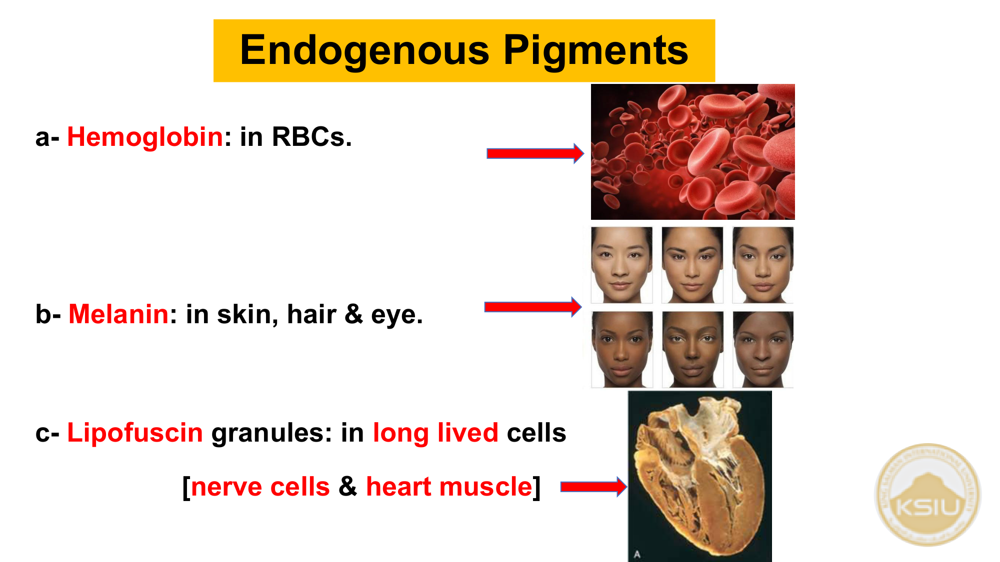
* **Hemoglobin** (هيموجلوبين): صبغة نقل الأكسجين الحمراء داخل كرات الدم الحمراء **RBCs**.
* **Melanin** (ميلانين): صبغة بنية داكنة تحمي من الأشعة فوق البنفسجية في الجلد **Skin**، الشعر **Hair**، والعين **Eye**.
* **Lipofuscin granules** (لايبوفيوسين جرانيولز): حبيبات صفراء مائلة للبني تسمى "صبغة الشيخوخة أو التلف والتآكل" (Wear and tear pigment)، وتتراكم في الخلايا المعمرة طويلة العمر **Long lived cells** مثل خلايا الأعصاب **Nerve cells** وعضلة القلب **Heart muscle**.

#### 2. صبغات خارجية المنشأ (Exogenous Pigments - إكسوجينَس بيجمنتس):
تدخل الجسم من البيئة الخارجية:
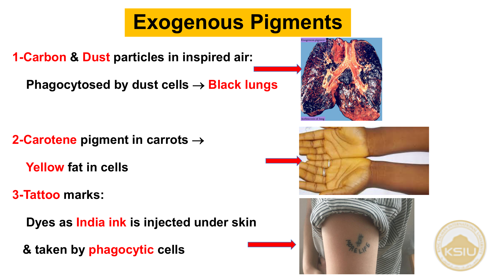
1. **Carbon & Dust particles** (جزيئات الكربون والغبار): تدخل مع هواء التنفس، تبتلعها خلايا الغبار البلعمية بالرئة (**Dust cells**)، وتؤدي لظهور رئة سوداء **Black lungs** (حالة الـ Anthracosis).
2. **Carotene pigment** (صبغة الكاروتين): صبغة غذائية مصدرها الجزر، تذوب في دهون الجسم فتعطي دهناً أصفر **Yellow fat in cells**.
3. **Tattoo marks** (علامات الوشم): حقن صبغات كالحبر الهندي **India ink** تحت الجلد، تبتلعها الخلايا البلعمية **Phagocytic cells** وتبقى ثابتة.

---

## 4️⃣ النواة (The Nucleus - ذا نيوكليَس)

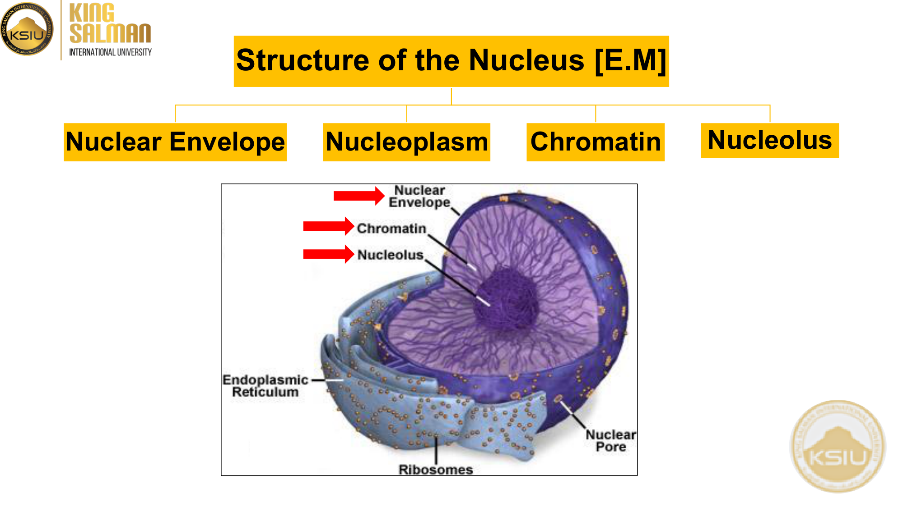

* **التعريف:** مركز القيادة والتحكم في جميع وظائف الخلية **The command center of the cell**.
* **تحت المجهر الضوئي (L.M):** تظهر كتركيب محب للقواعد **Basophilic structure** (تأخذ اللون الأزرق النيلي) لوجود الأحماض النووية الحمضية **DNA & RNA**.

---

### مكونات النواة بالمجهر الإلكتروني (4 مكونات أساسية):

#### 1. الغلاف النووي (Nuclear Envelope - نيوكليار إنفيلوب):
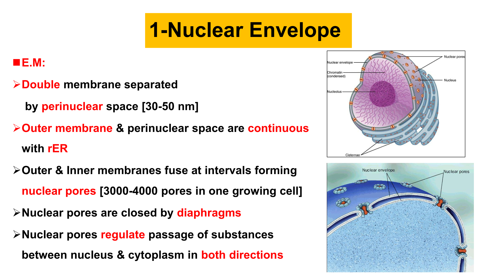
* غشاء مزدوج **Double membrane** يتكون من غشاء خارجي وداخلي.
* تفصل بين الغشائين مساحة حول نووية **Perinuclear space** (بيري نيوكليار سبيس) بسمك [30-50 نانومتر].
* الغشاء الخارجي والمساحة المحيطة متصلان مباشرة بالشبكة الإندوبلازمية الخشنة **rER**.
* يلتحم الغشاءان على مسافات لتكوين الثقوب النووية **Nuclear pores** (نيوكليار بورز) [3000-4000 ثقب في الخلية الواحدة النامية].
* هذه الثقوب مغلقة بحواجز غشائية **Diaphragms** (دايافرامز).
* **الوظيفة:** تنظيم مرور المواد بين النواة والسيتوبلازم في كلا الاتجاهين **Regulate passage in both directions**.

#### 2. السائل النووي (Nucleoplasm [Nuclear sap] - نيوكليوبلازم):
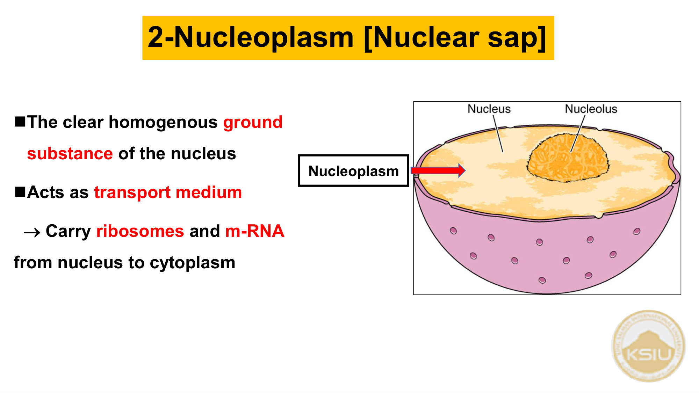
* المادة الخلالية المتجانسة والرائقة للنواة **Clear homogenous ground substance**.
* يعمل كوسط ناقل **Transport medium** لنقل الريبوسومات وجزيئات **m-RNA** من النواة إلى السيتوبلازم.

#### 3. الكروماتين (Chromatin - كروماتين):
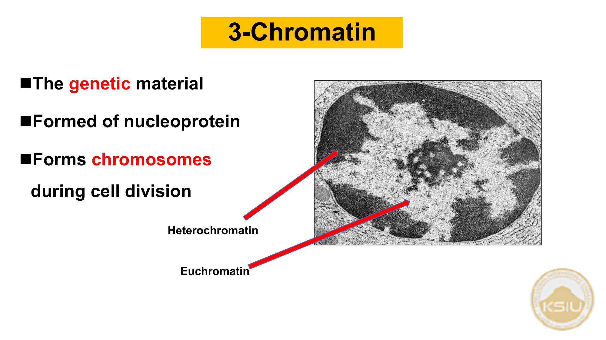
* المادة الوراثية للخلية **The genetic material**.
* يتكون من بروتين نووي **Nucleoprotein** (شريط DNA ملتف حول بروتينات الهستون Histones).
* يتكثف أثناء انقسام الخلية ليكوّن الصبغيات أو الكروموسومات **Chromosomes**.
* **مقارنة حاسمة بين نوعي الكروماتين (مهمة جداً للامتحانات):**

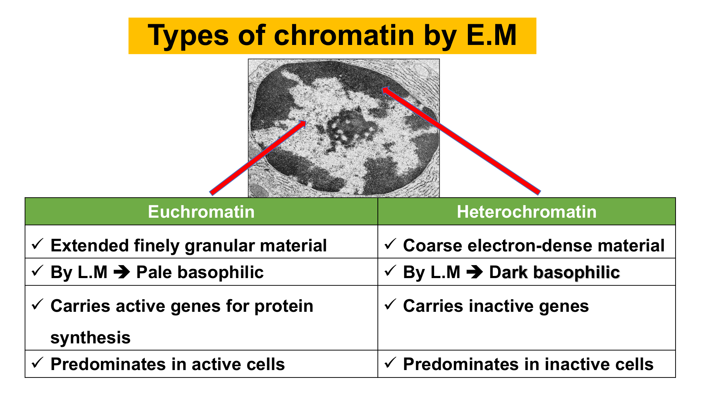

| وجه المقارنة | Euchromatin (يوكروماتين) | Heterochromatin (هيتيروكروماتين) |
| :--- | :--- | :--- |
| **المعنى الوظيفي** | الكروماتين الحقيقي الممتد / النشط | الكروماتين المكثف / غير النشط |
| **بالمجهر الإلكتروني (E.M)** | مادة ممتدة ومحببة بدقة (Extended finely granular material) | مادة كتلية خشنة كثيفة إلكترونياً (Coarse electron-dense material) |
| **بالمجهر الضوئي (L.M)** | شاحب الصبغ القاعدي (**Pale basophilic**) | غامق الصبغ القاعدي (**Dark basophilic**) |
| **نوع الجينات المحمولة** | يحمل جينات نشطة لتصنيع البروتين (Carries **active genes**) | يحمل جينات خاملة غير مفعلة (Carries **inactive genes**) |
| **نوع الخلايا التي يسود فيها** | يسود في الخلايا عالية النشاط (Predominates in **active cells**) | يسود في الخلايا الخاملة أو غير النشطة (Predominates in **inactive cells**) |

#### 4. النوية (Nucleolus - نيوكليولَس):
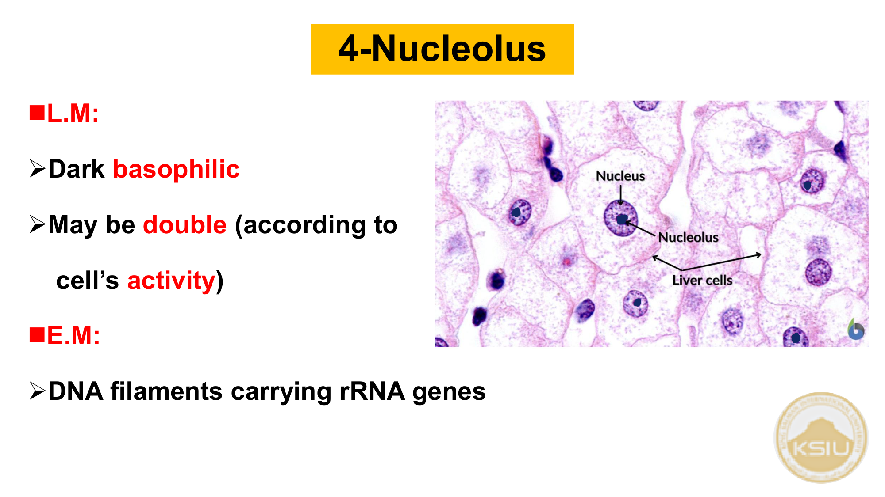
* **تحت المجهر الضوئي (L.M):** تظهر ككتلة داكنة الزرقة **Dark basophilic**، وقد تكون واحدة أو اثنتين حسب النشاط التصنيعي للخلية.
* **تحت المجهر الإلكتروني (E.M):** خيوط DNA تحمل جينات تصنيع الرنا الريبوسومي **rRNA genes**.
* **الوظيفة الحيوية:** مكان تصنيع **r-RNA**، أي تصنيع الأجزاء الريبوسومية.
  > ⚠️ **ملاحظة امتحانية دقيقة:** تتجمع وحدات الرنا مع البروتينات لتكوين الريبوسومات في **السيتوبلازم** وليس داخل النوية!

---

### وظائف النواة (Functions of the Nucleus):
1. التحكم في جميع وظائف الخلية وخاصة تصنيع البروتين (**Controls all cell functions / protein synthesis**).
2. حفظ وتخزين المعلومات والشفرات الوراثية (**Storage of genetic information**).
3. تصنيع الأنواع الثلاثة للحمض النووي الريبوزي: **mRNA, tRNA, rRNA**.
4. التحكم وتنظيم انقسام الخلية (**Controls cell division**).
5. تكوين الريبوسومات عبر نشاط النوية (**Function of the nucleolus**).

---

## 5️⃣ دليل التعرف على شرائح العملي (Practical Slides Revision)

هذا الدليل يلخص الجزء العملي التفاعلي في نهاية المحاضرة (الشرائح 34 إلى 59):

| # | المجهر / الصبغة | صورة الشريحة | التشخيص والتعليق النموذجي (Identification) |
| :---: | :---: | :---: | :--- |
| **1** | **E.M** |  | **EM of Heterolysosome** (هيتيرو لايسوسوم) حويصلة كبيرة غير متجانسة تحتوي أجساماً بلعمية ملتهمة وبكتيريا. |
| **2** | **E.M** |  | **EM of Multivesicular body** (ملتي فيسيكيولار بودي) حويصلة غشائية كبيرة تحتوي بداخلها حويصلات صغيرة ممتلئة بسوائل. |
| **3** | **E.M** |  | **EM of Autolysosome** (أوتو لايسوسوم) فجوة تحتوي على بقايا عضيات خلوية متحللة كالميتوكوندريا (Autophagy). |
| **4** | **L.M (Best's Carmine)** |  | **LM of Glycogen stained with Best's carmine** خلايا كبد مليئة بحبيبات جليكوجين حمراء واضحة (Red granules). |
| **5** | **E.M** |  | **EM of α-glycogen** (ألفا جلايكوجين) حبيبات مفردة متناثرة في السيتوبلازم قرب شبكة sER. |
| **6** | **E.M** |  | **EM of β-glycogen** (بيتا جلايكوجين) حبيبات جليكوجين متجمعة في عناقيد تشبه الورد (Rosettes). |
| **7** | **L.M (H&E)** |  | **LM of Fat cells (H&E)** (خلايا دهنية) خلايا ذات مظهر فجوات بيضاء فارغة (Empty vacuoles) لذوبان الدهون أثناء التحضير. |
| **8** | **L.M (Sudan III)** |  | **LM of Fat cells stained with Sudan III** قطرات وفجوات دهنية مصبوغة بلون برتقالي زاهٍ (Orange vacuoles). |
| **9** | **L.M (Sudan Black)** |  | **LM of Fat cells stained with Sudan Black** قطرات وفجوات دهنية مصبوغة بلون أسود قاتم (Black vacuoles). |
| **10** | **E.M** | 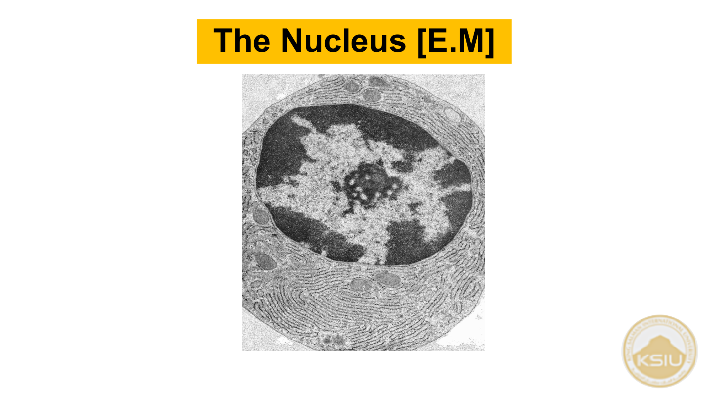 | **EM picture of a Nucleus** (النواة) غلاف نووي مزدوج مع نوية داكنة وتوزع الكروماتين. |
| **11** | **E.M** |  | **EM picture of Heterochromatin** (الكروماتين المكثف) الكتل السوداء المعتمة الإلكترونية المحيطية (Coarse electron-dense). |
| **12** | **E.M** |  | **EM picture of Euchromatin** (الكروماتين النشط) المناطق الفاتحة الممتدة المحببة في وسط النواة (Extended finely granular). |
| **13** | **E.M** |  | **EM picture of Nucleolus** (النوية) الكتلة الكروية الداكنة المتماسكة داخل النواة المسؤولة عن الـ rRNA. |
